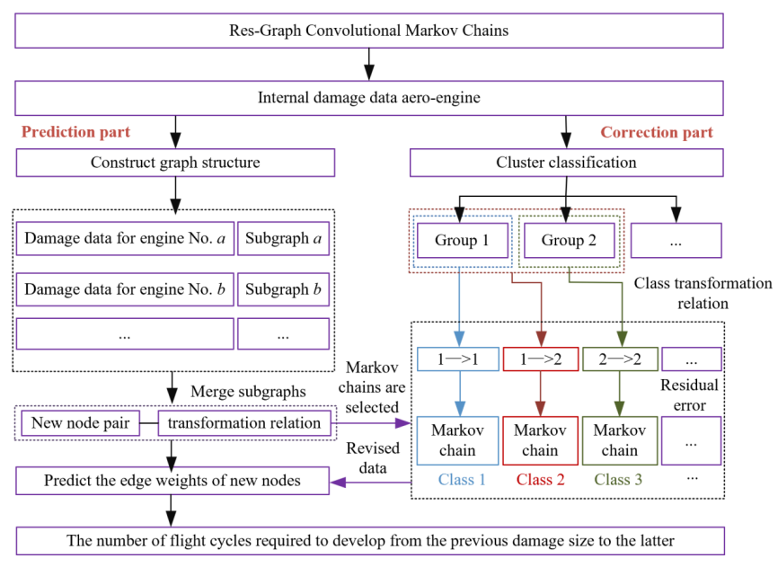
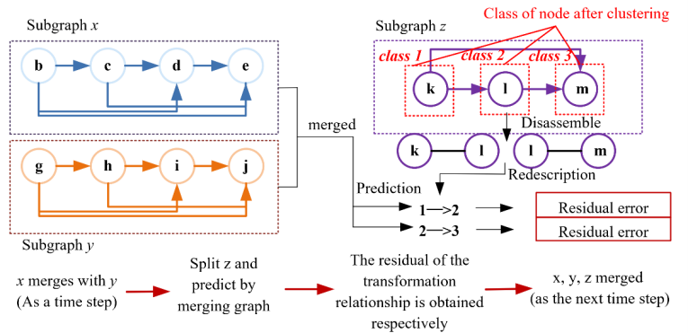

# Res-GCM

**基于残差图卷积 Markov 链的航空发动机损伤发展趋势预测**

[English](README.md) | [简体中文](README.zh-CN.md)

本项目提供 Res-GCM 的 Python 工程实现，用于预测两次连续损伤检查之间的飞行循环数。方法包含基于图的边权预测和按损伤转移类别进行的 Markov 残差校正。

## 总体框架



*图 1. Res-GCM 总体框架。*

## 方法

- **图结构构建：** 将检查记录表示为节点，每台发动机构成一个子图，并通过全局节点连接；过滤损伤尺寸逆向变化的记录。
- **图预测：** 使用残差图卷积编码器和边权解码器，结合损伤信息及图特征预测检查间隔对应的飞行循环数。
- **残差校正：** 将损伤尺寸划分为三个有序类别，利用留一发动机预测获得的残差序列构建分类型 Markov 模型，并校正预测结果。

### 按转移类别构建残差序列



*图 5. 子图合并过程中的转移类别预测与残差获取。*

## 安装

支持 Python 3.10 及以上版本：

```bash
python -m pip install -r requirements.txt
```

## 运行

训练 CSV 需要包含 `engine_id`、`cycles`（累计飞行循环数）及 `crack_length`（裂纹长度，mm）。每台训练发动机至少需要两条检查记录，且训练集至少包含三台发动机。

测试 CSV 可使用相同字段进行评估；如果没有真实飞行循环数，可使用 `engine_id`、`inspection_order`（检查先后顺序）及 `crack_length` 进行预测。训练集与测试集的发动机编号不能重复。

```bash
python run.py --train path/to/train.csv --test path/to/test.csv
```

可选参数包括 `--epochs`、`--seed`、`--hidden-dim`、`--lr`、`--dropout`、`--alpha` 和 `--residual-state-strategy`。预测结果保存至 `outputs/predictions.csv`，其中 `predicted_cycles` 为图网络预测结果，`revised_cycles` 为 Markov 校正结果。提供测试标签时会输出评价指标。

执行测试：

```bash
python -m pip install pytest
python -m pytest -q
```

## 论文引用

Wang, Z., Fu, X., & Zhang, J. (2024). *Res-GCM: A Damage Trend Prediction Method for Aero-Engines Based on Res-Graph Convolutional Markov Chains*. 2024 IEEE International Conference on Sensing, Diagnostics, Prognostics, and Control (SDPC). https://doi.org/10.1109/SDPC62810.2024.10707736

```bibtex
@inproceedings{wang2024resgcm,
  title={Res-GCM: A Damage Trend Prediction Method for Aero-Engines Based on Res-Graph Convolutional Markov Chains},
  author={Wang, Zhe and Fu, Xuyun and Zhang, Jinzhu},
  booktitle={2024 IEEE International Conference on Sensing, Diagnostics, Prognostics, and Control (SDPC)},
  year={2024},
  doi={10.1109/SDPC62810.2024.10707736}
}
```
